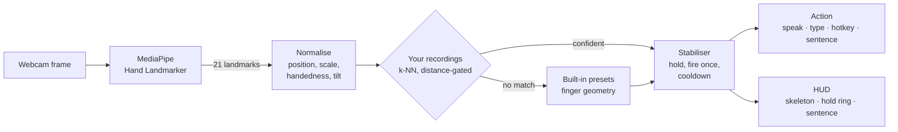

<div align="center">

# CogniSign

**Your hands have a voice.**

CogniSign turns hand gestures into speech, text and actions using nothing but a webcam.
It's an open-source communication aid for people who can't speak, or can't speak *right now*.


</div>

---

## Why

Millions of people live without a reliable voice: after throat surgery or laryngectomy, with
motor neurone disease, after a stroke, with selective mutism, or just with a sore throat that
won't let them talk for a week. The tools that exist are usually expensive dedicated devices or
tablet apps that need you to tap through menus.

Hands are faster than menus. CogniSign watches your hand through any webcam and, the moment
you hold a gesture, speaks for you.

- **Hold thumbs up and it says "Yes".** Hold thumbs down for "No". Peace sign for "Thank you".
- **Chain gestures into full sentences** ("Can I have some water, please.") and speak them in one go.
- **Teach it your own gestures in about five seconds**, so it works with the hand movements *you*
  can make, not just textbook signs.
- **Everything runs locally.** No video, landmarks or speech ever leave your computer.

## Features

| | |
|---|---|
| **Real-time hand tracking** | Google MediaPipe Hand Landmarker: 21 3D landmarks per hand at webcam frame rate on an ordinary laptop CPU. |
| **10 gestures out of the box** | Rule-based presets work on first launch with zero setup. |
| **Personal gestures** | Record your own; a distance-gated k-nearest-neighbour model learns them instantly, with no training step. |
| **Deliberate, not accidental** | Gestures must be held (600 ms by default) with a visible progress ring, fire once, and won't repeat until you change pose. |
| **Sentence builder** | AAC-style word chaining with undo, clear and speak. |
| **Offline voice** | Text-to-speech through your OS voices (SAPI5 / NSSpeechSynthesizer / eSpeak). |
| **Beyond speech** | Gestures can also type text or press shortcuts: control slides, media or any app hands-free. |
| **Pause gesture** | One gesture freezes everything so normal hand movement doesn't trigger anything. |
| **Left or right handed** | Left hands are mirrored onto the same templates automatically. |
| **Plain-text config** | One YAML file maps every gesture to an action. |

## Quick start

```bash
git clone https://github.com/z3zZ/CogniSign.git
cd CogniSign
python -m venv .venv
# Windows: .venv\Scripts\activate    macOS/Linux: source .venv/bin/activate
pip install -e .

cognisign doctor     # checks camera, voice, and downloads the hand model (~7.5 MB, once)
cognisign            # start
```

Or just run `start.bat` (Windows) / `./start.sh` (macOS, Linux), which does all of the above.

**In the window:** hold a gesture until the ring fills. `q` quits, `p` pauses, `c` clears the sentence.

## Default gestures

| Gesture | | Does |
|---|---|---|
| Thumbs up | 👍 | says "Yes" |
| Thumbs down | 👎 | says "No" |
| Open palm | ✋ | says "Hello" |
| Peace | ✌️ | says "Thank you" |
| OK | 👌 | says "I'm okay" |
| Call me | 🤙 | says "I need help, please" |
| Point | ☝️ | removes the last word from the sentence |
| Three fingers | | clears the sentence |
| Fist | ✊ | speaks the sentence |
| Rock | 🤘 | pauses / resumes CogniSign |

All of these can be changed.

## Teach it your own gestures

```bash
cognisign record water        # 3-second countdown, then hold the pose and move your hand a little
cognisign record please
cognisign gestures            # see everything CogniSign knows
```

Then map them in `~/.cognisign/config.yaml` (create it with `cognisign init`):

```yaml
gestures:
  water:  { action: phrase_add, value: "water" }
  please: { action: phrase_add, value: "please" }
  next:   { action: hotkey,     value: "right" }     # next slide
  sign:   { action: type,       value: "Kind regards, Sam" }
```

Recorded gestures take priority over the presets, so you can even redefine what "open palm"
looks like for your hand. `cognisign forget water` deletes one.

**Action types:** `speak`, `type`, `hotkey`, `phrase_add`, `phrase_speak`, `phrase_undo`,
`phrase_clear`, `toggle_pause`, `none`.

## How it works



1. **Tracking.** MediaPipe's Hand Landmarker finds the hand and returns 21 landmarks. Coordinates
   are corrected for the camera's aspect ratio so angles and distances are true to life.
2. **Normalisation.** The wrist moves to the origin, everything is scaled by palm length, left
   hands are mirrored, and the hand is rotated upright. That makes a gesture look the same whether
   it's near or far, left or right, tilted or straight. Palm direction is kept as a separate,
   weighted feature, because thumbs up and thumbs down are the same shape upside down.
3. **Recognition.** Your own recordings are matched with a k-nearest-neighbour vote. Poses that
   aren't close to *any* recording are rejected rather than guessed: for a communication aid,
   saying nothing beats saying the wrong thing. Otherwise CogniSign falls back to geometric rules
   on which fingers are extended.
4. **Stabilisation.** A per-frame guess isn't an intention. A gesture has to be held, fires once,
   and needs the hand to change pose before it can fire again. Brief tracking dropouts are forgiven
   so the hold ring doesn't reset on one bad frame.
5. **Action.** Speech runs on a background thread so the camera never stutters while it talks.

More detail in [docs/ARCHITECTURE.md](docs/ARCHITECTURE.md).

## Configuration

`cognisign init` writes `~/.cognisign/config.yaml`. The most useful settings:

| Setting | Default | What it does |
|---|---|---|
| `recognition.hold_ms` | 600 | How long to hold a gesture. Raise it if things fire by accident; lower it for speed. |
| `recognition.cooldown_ms` | 700 | Minimum gap between any two actions. |
| `recognition.max_distance` | 1.2 | How strict matching against your recordings is. Lower is stricter. |
| `camera.index` | 0 | Which webcam. |
| `voice.rate` | 170 | Speaking speed. |

Set `COGNISIGN_HOME` to keep config, recordings and model somewhere else (e.g. a USB stick).

## Privacy

CogniSign never records video and never connects to the internet, apart from downloading the
MediaPipe model file once. Recorded gestures are stored as landmark numbers in
`~/.cognisign/gestures.json`, not images.

## Development

```bash
pip install -e ".[dev]"
pytest          # 126 tests; synthetic hands, no camera needed
ruff check .
```

The test suite generates synthetic hands (rotated, scaled, mirrored, with landmark jitter) so
recognition, stabilisation, the sentence builder and the full run loop are tested end to end
without a webcam.

```
cognisign/
  features.py     landmark normalisation -> feature vectors
  presets.py      built-in gestures (finger geometry)
  classifier.py   gesture library + k-NN + recogniser
  stabiliser.py   hold / fire-once / cooldown state machine
  actions.py      speech, typing, hotkeys, sentence builder dispatch
  tracker.py      MediaPipe Hand Landmarker wrapper
  hud.py          on-screen feedback
  app.py          live loop (camera-agnostic, testable)
  recorder.py     record your own gestures
  cli.py          command line
```

## Roadmap

- [ ] Two-handed and moving gestures (sequence matching over time)
- [ ] Browser version (MediaPipe for web) so it runs from a link with no install
- [ ] British Sign Language fingerspelling pack
- [ ] Caregiver mode: big-text display of what was said, for noisy rooms
- [ ] Shareable gesture packs

## Story

CogniSign started in February 2026 as a computer-vision prototype for identification in a
defence setting, growing out of my [Intruder Detection](https://github.com/z3zZ/Intruder-Detection-app)
project. Building it made me realise the more meaningful use was the opposite of
surveillance: giving a voice to people who've lost theirs. v1.0 is a ground-up rebuild of that
prototype into a finished, tested, configurable tool.

## License

MIT. Use it, fork it, put it in front of someone who needs it.

Built by **Joshan Randhawa** ([@z3zZ](https://github.com/z3zZ)) · [joshan.dev](https://joshan.dev)
